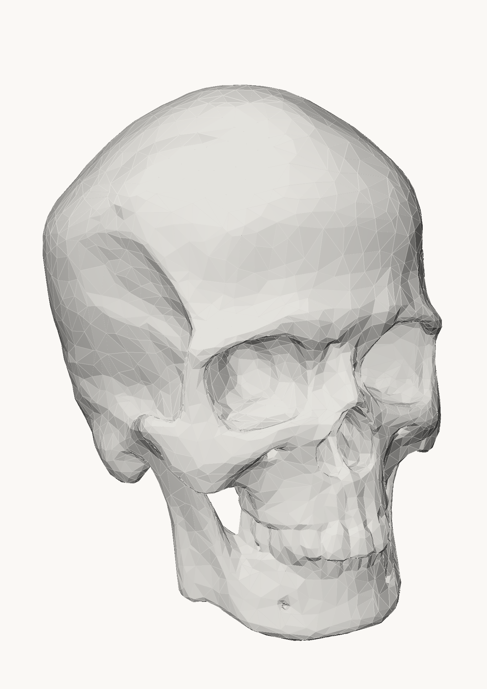
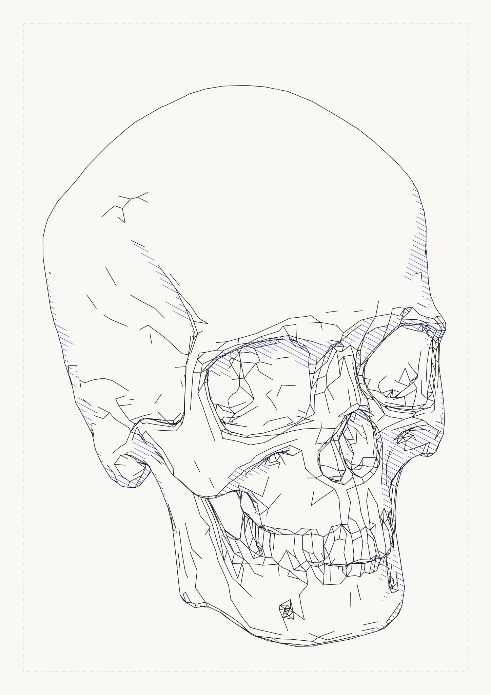
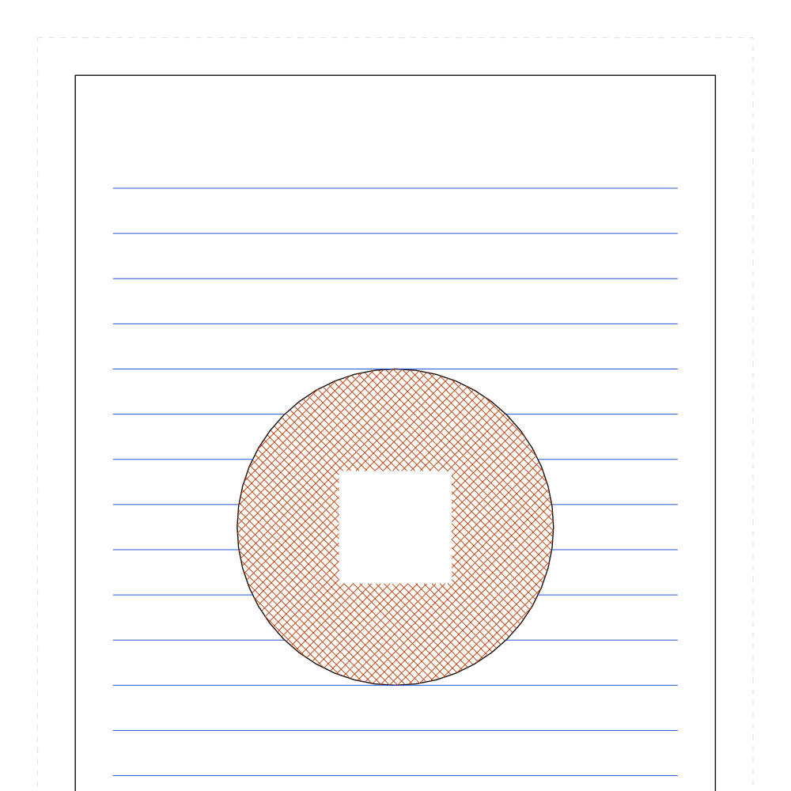
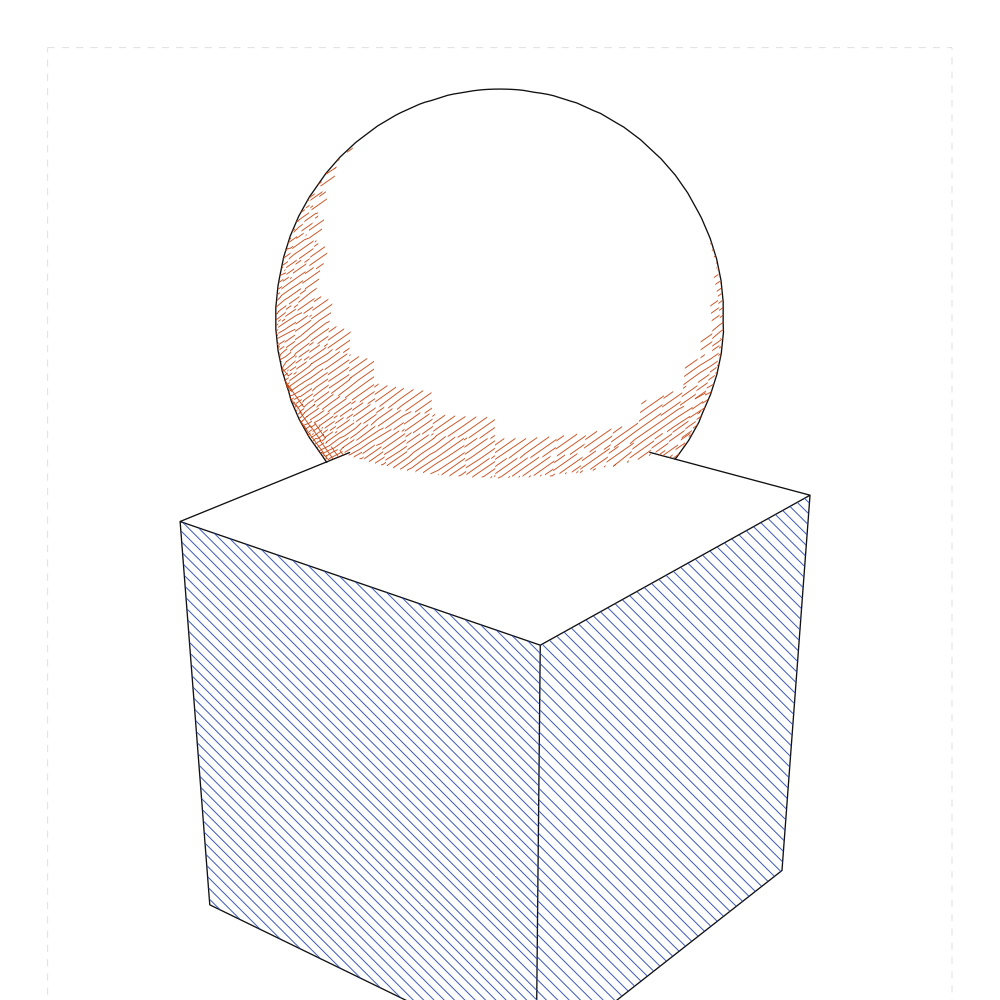
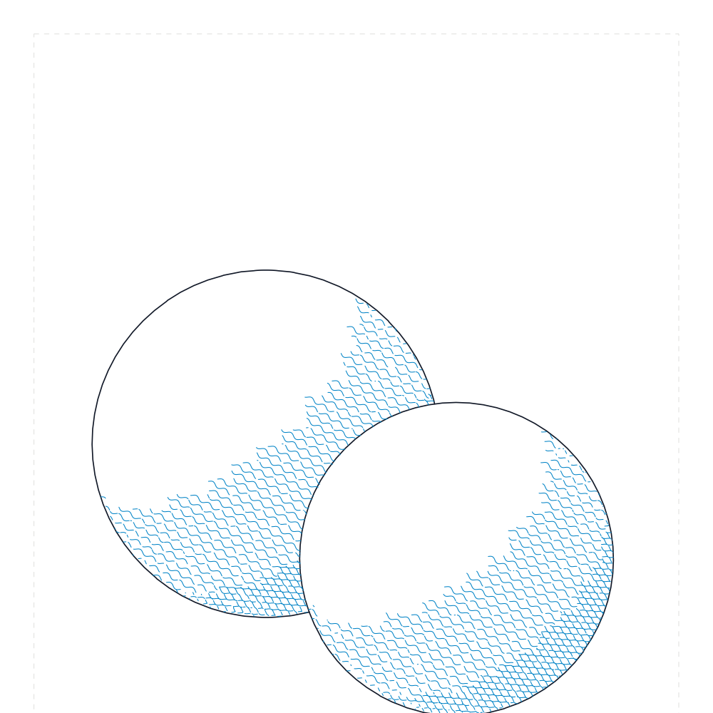

# Plotter Studio (`plotter-studio`)

A high-performance **TypeScript + WebGPU (`vgpu`)** library and interactive workspace for hardware-accelerated **hidden line removal** and **procedural hatching**. Exports clean, multi-layer SVG files ready for physical plotters.

Inspired by Gábor Ugray's technique ([*Fast line hiding with a WebGL shader for pen plots*](https://aka-gabor.xyz/texts/webgl-line-hiding/)).

<p align="center">
  
  &nbsp;
  
</p>
<p align="center">
  <em><strong>Anatomical Skull</strong> (10,000 polygons, <code>skull.glb</code>) — Left: WebGPU <code>rgba32float</code> G-Buffer depth &amp; normal rasterization. Right: Final vector SVG with feature silhouette outlines and directional engraving hatch shading.</em>
</p>

---

## Features

- **WebGPU-Accelerated Hidden Line Removal (HLR)**:
  - **Pass 1**: Rasterizes occluding faces into an offscreen 32-bit floating-point G-Buffer (`rgba32float` + `depth32float`).
  - **Pass 2**: Single-pass WGSL compute shader line marcher. Traverses candidate segment runs with orthogonal edge neighborhood searches and binary search boundary refinement.
- **2D & 3D Unified Engine**:
  - **3D Scenes**: Perspective / orthographic camera, automatic silhouette & dihedral crease detection, procedural meshes (`box`, `grid`, `sphere`, `polylines`), binary `.glb` mesh parser with vertex-clustering LOD decimation, and a first-class **Three.js adapter** (`fromThreeScene`).
  - **2D Scenes**: Physical millimetric canvas coordinates, painter's order / `zIndex` occlusion, positive clip masks (`clipToObjectId`), negative erase masks (`mode: "erase"`), and high-throughput occlusion benchmarks (e.g. 1,000 overlapping squares).
- **Procedural Hatching**:
  - Parallel engraving & cross-hatching.
  - **Meander / Serpentine Hatching**: Post-occlusion bridging of alternating parallel hatch lines within a configurable distance threshold (`hatchJoinDistanceMm`), transforming sets of individual hatch strokes into continuous serpentine paths to minimize pen lifts.
  - Light-directed shading: modulates line density based on surface normals and directional key lights.
  - Automatic global grid alignment for adjacent triangle meshes so lines meet tip-to-tip.
- **Plotter Path Optimization**:
  - Sub-segment micro-stitching across pixel steps.
  - Polyline chaining to minimize pen-up operations.
  - Configurable pen nib widths from ultra-fine `0.10 mm` up to broad `2.00 mm`.
  - Ramer–Douglas–Peucker (RDP) polyline simplification.
  - Windowed 2-Opt TSP path reordering (reverses and sorts paths to reduce air travel by 85–95%).
- **Multi-Layer SVG Output**:
  - Standard SVG export with physical units (`mm`), Inkscape-compatible layer groups (`inkscape:groupmode="layer"`), pen width stroke attributes, and optional travel path visualization.
  - Built-in paper presets.
- **Interactive Studio Playground**:
  - Live split-view comparing the WebGPU G-Buffer shading with real-time vector SVG rendering.
  - Viewport navigation toolbar with **Fit to View**, **Fill**, **1:1 (Actual Size)**, **200%**, and custom zoom levels with synchronized split-panel scrolling.
  - Real-time camera controls (orbit, pan, zoom), lighting, edge thresholds, paper size presets, hatch meander chaining, and drag-and-drop `.glb` model loading.

---

## Quick Start

### Installation

```bash
npm install plotter-studio
```

Ensure your environment supports WebGPU (Chrome/Edge/Brave 113+, Safari 18+, Firefox Nightly, or Node.js via `vgpu/node`).

---

### 2D "Hello World" Example

```typescript
import { createPlotter, PaperSize, HatchFill } from "plotter-studio";

// 1. Initialize plotter
const plotter = await createPlotter({
  paper: PaperSize.A4_PORTRAIT,
  penWidthMm: 0.25,
});

// 2. Build 2D scene in physical millimetric units
const scene = plotter.createScene2D();

scene.registerLayer({ id: "black", color: "#111111", strokeWidthMm: 0.3 });
scene.registerLayer({ id: "blue", color: "#1d4ed8", strokeWidthMm: 0.2 });

// Add background line grid (zIndex = 1)
for (let y = 50; y <= 240; y += 12) {
  scene.addPolyline({
    points: [[30, y], [180, y]],
    zIndex: 1,
    layer: "blue",
  });
}

// Add foreground circle that occludes background lines (zIndex = 5)
scene.addCircle({
  cx: 105,
  cy: 140,
  radius: 42,
  zIndex: 5,
  mode: "normal",
  stroke: { layer: "black" },
  fill: HatchFill.crossHatch({
    layer: "black",
    angleDeg: 45,
    spacingMm: 1.5,
  }),
});

// 3. Compute hidden line removal on the GPU with meander hatch chaining
const result = await plotter.plot(scene, {
  optimizeTravel: true,
  hatchJoinDistanceMm: 1.8, // Connects alternating adjacent hatch lines into continuous serpentine strokes
});

// 4. Export SVG
const svg = result.toSVG({ includePaperBorder: true });
console.log(svg);
```

---

### 3D "Hello World" Example

```typescript
import { createPlotter, PaperSize, HatchFill } from "plotter-studio";

const plotter = await createPlotter({
  paper: PaperSize.A4_PORTRAIT,
  penWidthMm: 0.2,
});

// 1. Setup 3D camera
const scene = plotter.createScene3D({
  position: [12, 10, 15],
  target: [0, 0, 0],
  fovDeg: 38,
});

scene.registerLayer({ id: "outlines", color: "#111111", strokeWidthMm: 0.28 });
scene.registerLayer({ id: "shading", color: "#1e40af", strokeWidthMm: 0.18 });

// 2. Add an occluding cube with directional lighting hatching
scene.addBox({
  size: [4.5, 4.5, 4.5],
  stroke: { layer: "outlines", silhouettes: true },
  fill: HatchFill.parallel({
    layer: "shading",
    angleDeg: 45,
    shadeByLight: {
      direction: [0.7, 1.0, 0.5],
      minSpacingMm: 0.5,
      maxSpacingMm: 2.0,
      highlightCutoff: 0.85,
    },
  }),
});

// 3. Add a sphere behind the cube
scene.addSphere({
  radius: 2.5,
  position: [-2.0, 3.2, -2.5],
  stroke: { layer: "outlines", silhouettes: true },
});

// 4. Execute GPU line marcher and TSP optimization
const result = await plotter.plot(scene, { optimizeTravel: true });
const svg = result.toSVG();
```

---

### Bring-Your-Own Hatching ("Sine Wave", Custom Curves, Procedural Patterns)

You can bring custom procedural hatching routines via `HatchFill.custom()`. The generator function receives a `HatchContext` with polygon vertices, perspective-correct depth interpolation (`ctx.interpolateZ(x, y)`), boundary clipping (`ctx.clipPolyline()`), and lighting normal data:

```typescript
import { HatchFill, getPolygonScanlineChords } from "plotter-studio";

const sineWaveHatch = HatchFill.custom((ctx) => {
  const spacingPx = 2.2 * ctx.pxPerMm;
  const amplitudePx = 0.55 * ctx.pxPerMm;
  const wavelengthPx = 4.5 * ctx.pxPerMm;

  // 1. Get base scanline chords across the polygon
  const chords = getPolygonScanlineChords(ctx.screenPoly, spacingPx, Math.PI / 4);
  const polylines = [];

  for (const chord of chords) {
    const dx = chord.x1 - chord.x0;
    const dy = chord.y1 - chord.y0;
    const len = Math.hypot(dx, dy);
    if (len < 1.0) continue;

    const nx = -dy / len;
    const ny = dx / len;
    const steps = Math.ceil(len / 1.5);
    const pts = [];

    for (let s = 0; s <= steps; s++) {
      const t = s / steps;
      const x = chord.x0 + dx * t;
      const y = chord.y0 + dy * t;
      const phase = (x / wavelengthPx) * Math.PI * 2;
      const waveX = x + nx * Math.sin(phase) * amplitudePx;
      const waveY = y + ny * Math.sin(phase) * amplitudePx;

      pts.push({
        xPx: waveX,
        yPx: waveY,
        z: ctx.interpolateZ(waveX, waveY), // exact perspective depth for 3D occlusion
      });
    }

    // Clip curve strictly inside polygon boundary
    polylines.push(...ctx.clipPolyline(pts));
  }

  return polylines;
}, { layer: "sine-waves" });
```

---

## Standalone Examples

Try the self-contained, dependency-free HTML/JS examples in the repository:

| 2D Occlusion & Erase Masks | 3D Mesh Shading & Occlusion | Bring-Your-Own Sine Wave Hatch |
|:---:|:---:|:---:|
|  |  |  |
| [**`hello-world-2d.html`**](https://tenebrisvia.github.io/PlotterStudio/dist/examples/hello-world-2d.html)<br>Millimetric 2D coordinates, painter's order, cross-hatching, and negative erase cutout masks | [**`hello-world-3d.html`**](https://tenebrisvia.github.io/PlotterStudio/dist/examples/hello-world-3d.html)<br>3D camera perspective, geometric cube + sphere, and directional light-modulated engraving | [**`hello-world-custom-hatch.html`**](https://tenebrisvia.github.io/PlotterStudio/dist/examples/hello-world-custom-hatch.html)<br>Procedural sine wave hatching with lighting-modulated density and 3D depth occlusion |

Launch the local development server:
```bash
npm run dev
```
Open any example directly in your browser:
- [http://localhost:5173/examples/hello-world-2d.html](http://localhost:5173/examples/hello-world-2d.html)
- [http://localhost:5173/examples/hello-world-3d.html](http://localhost:5173/examples/hello-world-3d.html)
- [http://localhost:5173/examples/hello-world-custom-hatch.html](http://localhost:5173/examples/hello-world-custom-hatch.html)
- [http://localhost:5173/](http://localhost:5173/) (Interactive Studio Playground)


---

## Why `vgpu`? (WebGPU Architecture & Rationale)

This library builds on [**`vgpu`**](https://github.com/vercel-labs/vgpu) rather than authoring against raw browser WebGPU APIs directly. While all underlying shaders are standard WGSL, `vgpu` acts as a high-productivity runtime harness that eliminates ~800+ lines of low-level GPU orchestration boilerplate:

- **Automatic WGSL Reflection & Layout Synthesis (`@vgpu/wgsl/prepare`)**:
  Raw WebGPU requires authoring verbose `GPUBindGroupLayoutDescriptor` and `GPUPipelineLayoutDescriptor` objects for every buffer, uniform, and texture stage. `vgpu` parses the WGSL AST directly, automatically deriving stage visibility, resource types, and bind group caches from your shader declarations.
- **Automated Buffer Staging & Row-Pitch Alignment**:
  Reading back GPU data normally requires creating staging buffers (`MAP_READ`), encoding copy commands, awaiting async mapping, and manually unpacking WebGPU's mandatory 256-byte row stride alignment (`bytesPerRow`). `vgpu` encapsulates this into clean `buffer.read()` and `target.color.read()` calls.
- **Universal Browser + Headless Node.js Runtime**:
  **Plotter Studio** runs identically in modern browsers (via `navigator.gpu`) and in headless Node.js environments (via `vgpu/node` + Dawn/Vulkan) using the exact same codebase, enabling headless CLI SVG generation and Vitest unit testing without platform-specific `#if` checks.
- **Fullscreen Quad Generation (`effect`)**:
  The G-Buffer preview pass uses `effect(gpu, PREVIEW_SHADER)`, which generates a fullscreen triangle vertex stage automatically from a fragment-only shader without manual vertex buffer state management.

---

## Running the Headless CLI Benchmark

Render the 4 built-in benchmark scenes directly to multi-layer SVG files and PNG G-Buffer previews via Node.js (`vgpu/node`):

```bash
npm run plot:cli
```

Outputs are generated in `./output/`:
1. `alpine-mountains-2d.svg`: Pure 2D landscape with layered mountain ridges, alpenglow sun rays, positive water reflection masks, and foreground conifer trees.
2. `random-squares-1000.svg`: 2D stress test of 1,000 random overlapping rotated squares (2,000 triangles, 7,500+ candidate segments) evaluating GPU occlusion throughput and travel optimization.
3. `threejs-adapter.svg`: Live conversion of a Three.js scene (`Scene`, `Mesh`, `TorusGeometry`, `BoxGeometry`) via `fromThreeScene`.
4. `skull-glb.svg`: Binary `.glb` asset loading with 10,000 decimation clusters and directional engraving hatching.

---

## License

[MIT](LICENSE) © 2026 TenebrisVia

---

Vibe-coded with Gemini 4 Argon